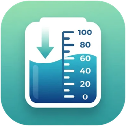
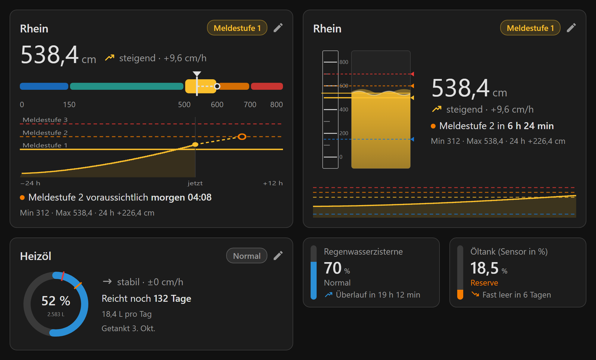
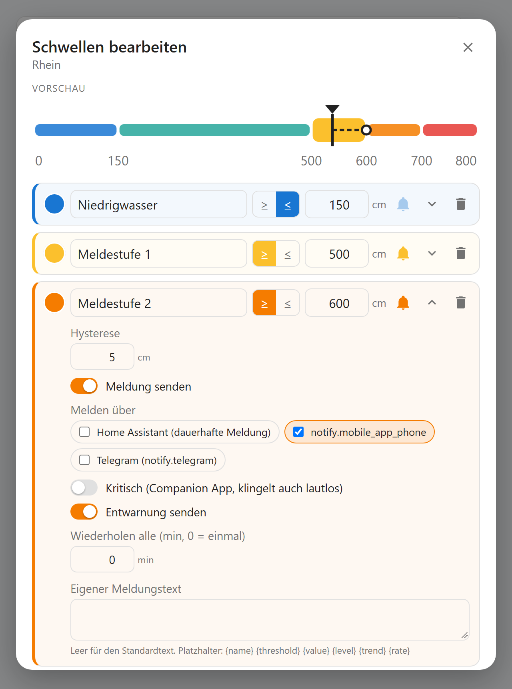
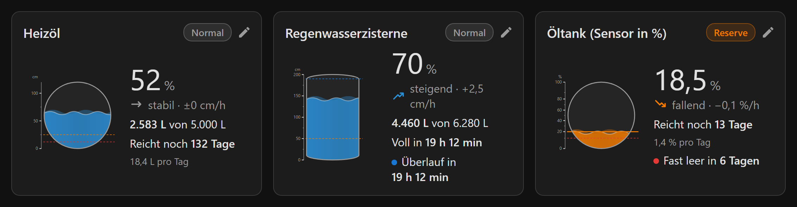

# Level Watch für Home Assistant

<p align="center">
  <a href="https://github.com/berwil84afk/ha-level-watch/releases"></a>
  <picture></picture>
  <picture></picture>
  <a href="https://github.com/berwil84afk/ha-level-watch/issues"></a>
  <picture></picture>
  <a href="https://hacs.xyz/docs/faq/custom_repositories/"></a>
  <picture></picture>
  <a href="https://github.com/berwil84afk/ha-level-watch/actions/workflows/validate.yml"></a>
  <a href="https://buymeacoffee.com/berwil84afk"></a>
</p>

[English](README.md) · **Deutsch** · [Änderungsprotokoll](CHANGELOG.de.md)

Level Watch überwacht einen **Wasserpegel** (Fluss, Teich, Brunnen) oder einen **Tank** (Zisterne, Heizöl) mit einem Sensor, den du schon hast. Die Integration berechnet die Tendenz, warnt dich bei Schwellen, die du festlegst, sagt voraus, wann die nächste erreicht wird, und bringt eine eigene Dashboard-Karte mit.



## Funktionen

- **Pegel und Tendenz:** geglätteter Pegel, Änderungsrate pro Stunde, Tendenz (steigend, fallend, stabil), Minimum, Maximum und Änderung der letzten 24 Stunden.
- **Schwellen:** beliebig viele, nach oben (Hochwasser, voller Tank) oder nach unten (Niedrigwasser, Reserve), jeweils mit Hysterese und eigener Farbe.
- **Meldungen:** über die Companion App (auf Wunsch als kritische Mitteilung, die auch bei lautlosem Handy klingelt), als dauerhafte Meldung in Home Assistant oder über jeden anderen Benachrichtigungsdienst wie Telegram oder E-Mail. Entwarnung und Wiederholung sind möglich.
- **Prognose:** welche Schwelle als Nächstes kommt und wann sie bei der aktuellen Rate erreicht ist.
- **Tanks:** Volumen in Litern für stehende und liegende Zylinder und Quader, dazu Verbrauch pro Tag, Reichweite in Tagen, Zeit bis voll und das Erkennen von Nachtanken.
- **Sensoren in %, kg oder L:** Auch ein Füllstandssensor in Prozent funktioniert, ebenso eine Waage, zum Beispiel für das Salz einer Enthärtungsanlage, oder ein Sensor, der den Inhalt in Litern meldet.
- **Karte:** vier Stile, Skala, Schwellenlinien mit Tooltips, Verlauf der letzten 24 Stunden und ein Schwelleneditor für Admins.
- **Zuverlässig:** Messwerte und der Zustand der Schwellen überstehen einen Neustart, keine Meldung kommt doppelt. Ein ausgefallener Sensor löst keinen Alarm aus.

> Level Watch ersetzt keine amtlichen Hochwasserwarnungen.

## Voraussetzungen

- Home Assistant 2025.2 oder neuer. Das Icon der Integration erscheint ab Home Assistant 2026.
- Ein Sensor, der den Pegel als Länge (mm, cm, m, in, ft), in %, als Gewicht (g, kg, lb) oder als Volumen (L, m³, gal) meldet.

## Installation

### HACS (empfohlen)

1. Öffne in HACS das Menü (⋮) und wähle **Benutzerdefinierte Repositories**.
2. Füge `https://github.com/berwil84afk/ha-level-watch` mit dem Typ **Integration** hinzu.
3. Suche nach **Level Watch**, lade die Integration herunter und starte Home Assistant neu.

### Von Hand

1. Kopiere den Ordner `custom_components/level_watch` nach `/config/custom_components/level_watch`.
2. Starte Home Assistant neu.

## Einrichtung

Gehe zu **Einstellungen → Geräte & Dienste → Integration hinzufügen → Level Watch**. Für jeden Pegel, den du überwachen willst, legst du einen eigenen Eintrag an.

| Feld | Bedeutung |
|---|---|
| Pegelsensor | Der Sensor, der den Pegel oder den Abstand bis zur Oberfläche meldet. |
| Einheit des Sensors | *Automatisch* nimmt die Einheit des Sensors. Wähle eine aus, wenn der Sensor keine hat. |
| Art | *Wasserpegel* oder *Tank*. |
| Messart | *Pegel*: Der Sensor meldet die Höhe der Oberfläche. *Abstand von oben*: Der Sensor sitzt oben und misst nach unten bis zur Oberfläche, wie die meisten Ultraschall- und Radarsensoren. |
| Einbauhöhe des Sensors | Nur bei *Abstand von oben*: Höhe des Sensors über dem Nullpunkt, zum Beispiel über dem Tankboden. |
| Korrektur | Wird zu jedem Messwert addiert, zum Beispiel um den Pegelnullpunkt zu korrigieren. |
| Bezug unten / oben | Die Pegel, die als 0 % und 100 % gelten. Sie legen auch den Bereich der Karte fest. Trag beim Tank den maximalen Füllstand als *Bezug oben* ein, damit Füllstand, Skala und Tankgrafik stimmen. |
| Tank | Nur bei Tanks: Form und Innenmaße (siehe [Tanks](#tanks)). |

### Woher der Pegel kommen kann

- **Ultraschall- oder Radarsensoren**, zum Beispiel über ESPHome oder Tasmota.
- **Drucksensoren** im Brunnen oder Tank.
- **Amtliche Flusspegel** über die mitgelieferte Integration [PEGELONLINE](https://www.home-assistant.io/integrations/pegel_online/) (Bundeswasserstraßen). Daten: WSV, PEGELONLINE, Lizenz DL-DE->Zero-2.0. Es sind ungeprüfte Rohdaten.
- **Füllstandssensoren in %**, etwa von einer Heizöl- oder Zisternenanzeige. Pegel, Bezüge, Schwellen, Rate (%/h) und die Karte arbeiten dann in %. Beim Tank bekommst du den Verbrauch in % pro Tag und die Reichweite in Tagen, aber keine Liter. Ohne *Bezug oben* gilt 100 %. *Abstand von oben* ist mit % nicht möglich.
- **Waagen in g, kg oder lb**, zum Beispiel unter dem Salzbehälter einer Enthärtungsanlage. Der Pegel wird in kg geführt, die Rate in kg/h. Als Tank bekommst du den Verbrauch in kg pro Tag, die Reichweite in Tagen und das Erkennen von Nachfüllen, wenn du einen neuen Sack einfüllst. Mit *Bezug oben* (zum Beispiel 50 kg) wird der Füllstand in % angezeigt. Die Karte füllt den Behälter mit Körnern statt mit Wasser.
- **Volumensensoren in L, m³ oder gal**, zum Beispiel ein Tanksensor, der seinen Inhalt schon in Litern meldet. Der Pegel wird in Litern geführt, die Rate in L/h, und ein Tank bekommt den Verbrauch in Litern pro Tag, die Reichweite in Tagen und das Erkennen von Nachtanken. Mit *Bezug oben* (zum Beispiel 1500 L) wird der Füllstand in % angezeigt. Eine Tankform brauchst du nicht, weil der Sensor das Volumen schon meldet.

## Schwellen und Meldungen

Schwellen legst du auf drei Wegen an:

1. **In der Karte:** Admins sehen oben rechts in der Karte einen Stift. Er öffnet den Schwelleneditor mit Vorschau.
2. **Aus einer Vorlage:** **Level Watch → Konfigurieren → Schwellen aus Vorlage hinzufügen.**
   - *Flusspegel:* Niedrigwasser und Meldestufe 1 bis 4.
   - *Tank:* fast leer, Reserve und voll.
   - Trag nur die Werte ein, die du brauchst. Name, Farbe, Richtung und Hysterese sind schon ausgefüllt.
3. **Einzeln:** **Level Watch → Konfigurieren → Schwellenwert hinzufügen.**



Jede Schwelle hat diese Einstellungen:

| Einstellung | Bedeutung |
|---|---|
| Name, Wert | Zum Beispiel *Meldestufe 1* bei 500 cm. |
| Richtung | Erreicht, wenn der Pegel *auf oder über den Wert steigt* (Hochwasser, voller Tank) oder *auf oder unter den Wert fällt* (Niedrigwasser, Reserve). |
| Hysterese | So weit muss der Pegel zurückgehen, bevor die Schwelle aufgehoben wird. Das verhindert eine Flut von Meldungen, wenn der Pegel um den Wert pendelt. Vorgabe: 2 cm. |
| Farbe | Farbe dieser Stufe in der Karte. |
| Meldung senden, Melden über | Companion App, dauerhafte Meldung oder jeder andere Benachrichtigungsdienst. |
| Kritisch | Nur Companion App: Die Meldung klingelt auch, wenn das Handy lautlos ist. |
| Meldungstext | Leer lassen für den Standardtext. Platzhalter: `{name}`, `{threshold}`, `{value}`, `{level}`, `{trend}`, `{rate}`. |
| Entwarnung senden | Auch melden, wenn die Schwelle aufgehoben ist. |
| Wiederholen alle | Meldung wiederholen, solange die Schwelle gilt. 0 bedeutet einmal. |

**Meldung testen:** Im Schwelleneditor der Karte schickt *Test senden* die Meldung einer Schwelle einmal an die gewählten Ziele, mit dem aktuellen Pegel und als *Test:* markiert. Das geht auch vor dem Speichern. Sonst ändert sich nichts: kein Ereignis, keine Stufe, keine Wiederholung. In Automationen oder unter **Entwicklerwerkzeuge → Aktionen** geht dasselbe mit der Aktion `level_watch.send_test`:

```yaml
action: level_watch.send_test
data:
  entity_id: sensor.rhein_pegel
  threshold: Meldestufe 1   # optional, ohne sie werden alle Schwellen mit Meldung getestet
```

Schwellen werden nur geprüft, solange die Datenqualität *OK* ist. Ein ausgefallener oder veralteter Sensor löst also nie einen Alarm aus. Willst du darüber auch informiert werden, baue eine Automation auf den Sensor *Datenqualität*.

> **Tipp für Flusspegel:** Auf der Seite jeder PEGELONLINE-Messstelle stehen Kennwerte wie MNW (mittleres Niedrigwasser), NNW (niedrigstes bekanntes Niedrigwasser) und HHW (höchstes bekanntes Hochwasser). Sie sind in cm über dem Pegelnullpunkt angegeben, genau wie die Messwerte der PEGELONLINE-Integration. Du kannst sie also direkt als Schwellen eintragen.

### Automationen

Jedes Mal, wenn eine Schwelle erreicht oder aufgehoben wird, löst Level Watch das Ereignis `level_watch_threshold` mit `name`, `threshold`, `value`, `direction`, `active` und `level` aus:

```yaml
triggers:
  - trigger: event
    event_type: level_watch_threshold
    event_data:
      threshold: Meldestufe 2
      active: true
actions:
  - action: switch.turn_on
    target:
      entity_id: switch.pumpe
```

## Sensoren

| Sensor | Was er zeigt |
|---|---|
| Pegel | Geglätteter Pegel in cm (oder %, kg oder L). Die Anzeigeeinheit kannst du in Home Assistant ändern. |
| Füllstand | Pegel in % zwischen *Bezug unten* und *Bezug oben*. Bei Tanks mit Form nach Volumen. |
| Tendenz | Steigend, fallend oder stabil. |
| Änderungsrate | cm (oder %, kg oder L) pro Stunde, berechnet über das Zeitfenster der Tendenz. |
| Minimum / Maximum 24 h | Niedrigster und höchster Wert der letzten 24 Stunden. |
| Änderung 24 h | Unterschied zu vor 24 Stunden. |
| Datenqualität | OK, veraltet, Sensor nicht verfügbar oder keine Daten. |
| Stufe | Name der schwersten aktiven Schwelle oder *Normal*. Die Farbe steht im Attribut `color`. |
| Nächste Schwelle | Die Schwelle, auf die sich der Pegel zubewegt. |
| Zeit bis nächste Schwelle | Stunden bis dahin bei der aktuellen Rate. |
| Ein Binärsensor je Schwelle | An, solange die Schwelle erreicht ist. |

*Stufe*, *Nächste Schwelle* und *Zeit bis nächste Schwelle* gibt es erst, wenn mindestens eine Schwelle angelegt ist.

## Tanks

Bei der Art *Tank* trägst du im Abschnitt **Tank** die Form und die Innenmaße ein. Der Nullpunkt ist der Tankboden. Liegt der Nullpunkt deines Sensors woanders, gleichst du das mit *Korrektur* aus.

| Form | Maße |
|---|---|
| Stehender Zylinder | Durchmesser |
| Liegender Zylinder | Durchmesser, Länge |
| Quader | Länge, Breite |



Damit kommen diese Sensoren dazu:

| Sensor | Was er zeigt |
|---|---|
| Volumen | Inhalt in Litern. Das Fassungsvermögen steht im Attribut `capacity`. |
| Freies Volumen | So viel passt noch hinein bis *Bezug oben* (beim liegenden Zylinder ohne Bezug bis zum vollen Durchmesser). |
| Verbrauch pro Tag | Liter pro Tag, gemittelt seit dem letzten Nachtanken. Der Wert erscheint nach 12 Stunden Daten. |
| Reichweite | Tage, bis *Bezug unten* bei diesem Verbrauch erreicht ist. |
| Zeit bis voll | Stunden bis *Bezug oben*, solange der Pegel steigt. Auch ohne Form. |
| Letztes Nachtanken | Wann zuletzt Nachtanken erkannt wurde. Auch ohne Form. |

Mit Form wird der Füllstand nach Volumen berechnet. Beim liegenden Zylinder ist die halbe Höhe genau 50 %, ein Viertel der Höhe aber nur etwa 20 %.

Steigt der Pegel binnen zwei Stunden um 5 cm oder mehr, gilt das als Nachtanken (einstellbar). Auch Regen in der Zisterne zählt so. Der Verbrauch wird danach neu berechnet.

## Karte

Die Integration bringt die Karte selbst mit, du musst keine Ressource eintragen. Bearbeite ein Dashboard, wähle **Karte hinzufügen** und dann **Level Watch**. Alles lässt sich im Karteneditor einstellen.

| Stil | Gut für |
|---|---|
| `forecast` (Standard) | Flüsse und alles, wo es auf das *Wann* ankommt: Zonenbalken mit den Stufen, Verlauf und gestrichelte Prognose bis zur nächsten Schwelle, dazu eine Zeile wie *Meldestufe 2 voraussichtlich morgen 04:07*. |
| `classic` | Pegellatte mit Becken oder der Tank in seiner echten Form, beides mit Skala und bewegtem Wasser. |
| `ring` | Tanks: Füllstandsring mit Schwellenmarken, Reichweite, Verbrauch und letztem Nachtanken. |
| `compact` | Kachel für halbe Breite mit Balken, Wert, Stufe und kurzem Hinweis. |

Wasser und Akzente nehmen die Farbe der aktiven Stufe an. Fährst du mit der Maus über eine Zone oder eine Schwellenlinie, siehst du Name und Wert.

Bei Gewichten ist der Behälter statt mit Wasser mit ruhigen Körnern in Graublau gefüllt. Mit `fill` wählst du die Füllung selbst, `color` legt die Füllfarbe fest, solange keine Schwelle aktiv ist.

```yaml
type: custom:level-watch-card
entity: sensor.rhein_pegel   # oder eine andere Entität desselben Level-Watch-Geräts
style: forecast              # forecast, classic, ring oder compact
title: Rhein                 # optional, sonst der Gerätename
mode: auto                   # auto, water oder tank
show_history: true           # false blendet den Verlauf aus
history_hours: 24            # Länge des Verlaufs
forecast_hours: 12           # wie weit die Prognose reicht
fill: auto                   # auto, water oder granules (auto: Körner bei kg)
color: [43, 143, 214]        # optional, Füllfarbe, solange keine Schwelle aktiv ist
```

## Erweiterte Einstellungen

Unter **Level Watch → Konfigurieren → Sensor- und Tendenzeinstellungen**, Abschnitt *Tendenz und Datenqualität*:

| Einstellung | Vorgabe | Wirkung |
|---|---|---|
| Zeitfenster Tendenz | 60 min | Zeitraum, über den die Änderungsrate berechnet wird. |
| Stabilbereich | 1 pro Stunde | Raten innerhalb von plus oder minus diesem Wert gelten als stabil. |
| Glättung | 5 min | Median über diesen Zeitraum, entfernt einzelne Ausreißer. 0 schaltet sie aus. |
| Veraltet nach | 60 min | Meldet der Sensor so lange nichts, gelten die Daten als veraltet. |
| Max. Sprung | 0 (aus) | Größere Sprünge zählen erst, wenn 3 Messungen sie bestätigen. |
| Zeitraum Verbrauch | 7 Tage | Nur Tank: Zeitraum, über den der Tagesverbrauch gemittelt wird. |
| Nachtanken erkennen ab | 5 | Nur Tank: So viel Anstieg binnen zwei Stunden gilt als Nachtanken. 0 schaltet es aus. |

*Stabilbereich* und *Nachtanken erkennen ab* nutzen die Einheit des Pegels: cm, %, kg oder L.

Für einen Heizöltank, dessen Pegel nur langsam fällt, passen ein langes Zeitfenster (zum Beispiel 1440 min) und ein kleiner Stabilbereich (zum Beispiel 0,05 cm/h) am besten.

## Fehlersuche

- **Die Karte sieht nach einem Update alt aus:** Lade die Seite mit Strg+F5 neu. In der Companion App setzt du dafür in den App-Einstellungen den Frontend-Cache zurück.
- **Die Datenqualität zeigt *Sensor nicht verfügbar*:** Der Quellsensor ist nicht erreichbar oder meldet eine andere Einheit als beim Einrichten.
- **Kein Verbrauch und keine Reichweite:** Dafür braucht es mindestens 12 Stunden Daten seit dem letzten Nachtanken.

## Entwicklung

```bash
pip install -r requirements_test.txt
pytest
```

Die Karte ohne Home Assistant ansehen: Starte `python -m http.server 8766` im Repository und öffne `http://127.0.0.1:8766/dev/preview.html`. Mit `?style=ring` (oder einem anderen Stil) siehst du nur diesen Stil.

Die Screenshots in diesem README entstehen mit `python dev/make_screenshots.py`, während dieser Server läuft. Dafür brauchst du Chrome oder Edge und Pillow.

## Unterstützung

Fehler gefunden oder eine Idee? Leg ein [Issue](https://github.com/berwil84afk/ha-level-watch/issues) an.

Wenn dir Level Watch hilft, kannst du mir einen Kaffee spendieren:

<a href="https://buymeacoffee.com/berwil84afk"></a>

## Lizenz

MIT, siehe [LICENSE](LICENSE).
