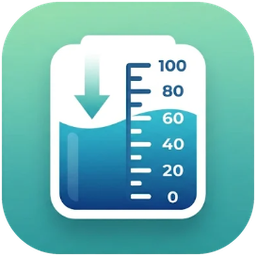
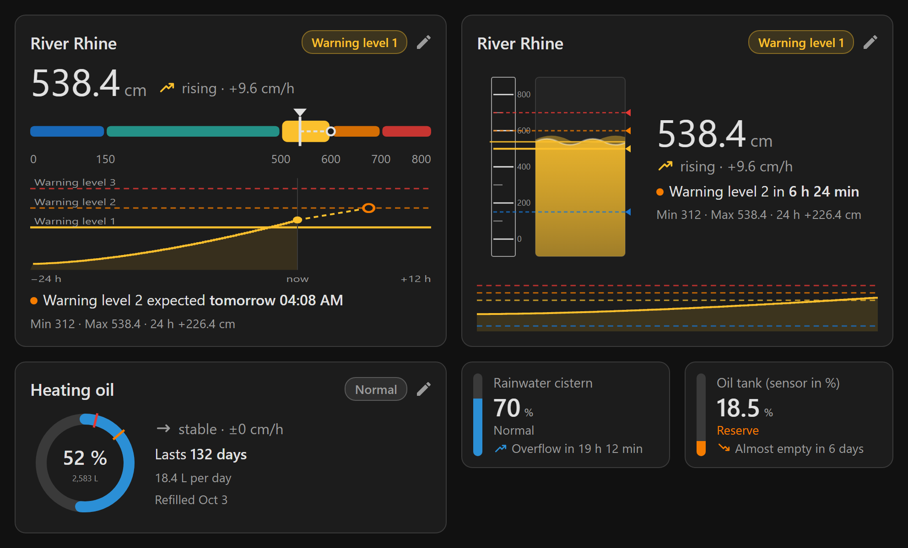
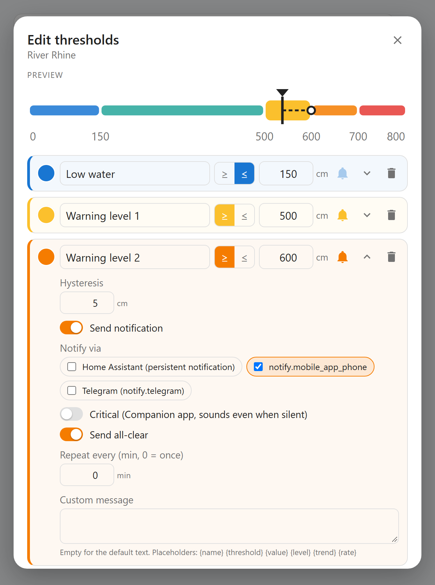
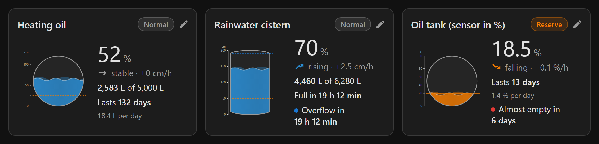

# Level Watch for Home Assistant

<p align="center">
  <a href="https://github.com/berwil84afk/ha-level-watch/releases"></a>
  <picture></picture>
  <picture></picture>
  <a href="https://github.com/berwil84afk/ha-level-watch/issues"></a>
  <picture></picture>
  <a href="https://hacs.xyz/docs/faq/custom_repositories/"></a>
  <picture></picture>
  <a href="https://github.com/berwil84afk/ha-level-watch/actions/workflows/validate.yml"></a>
  <a href="https://buymeacoffee.com/berwil84afk"></a>
</p>

**English** · [Deutsch](README.de.md) · [Changelog](CHANGELOG.md)

Level Watch monitors a **water level** (river, pond, well) or a **tank** (cistern, heating oil) using a sensor you already have. It works out the trend, warns you at thresholds you set, forecasts when the next one will be reached and comes with its own dashboard card.



## Features

- **Level and trend:** smoothed level, rate of change per hour, trend (rising, falling, stable), minimum, maximum and change over the last 24 hours.
- **Thresholds:** as many as you like, upwards (flood, full tank) or downwards (low water, reserve), each with hysteresis and its own colour.
- **Notifications:** Companion app (optionally as a critical alert that sounds even on silent), persistent notification in Home Assistant or any other notify service such as Telegram or email. Optional all-clear and repeat.
- **Forecast:** which threshold comes next and when it will be reached at the current rate.
- **Tanks:** volume in litres for vertical cylinders, horizontal cylinders and boxes, plus consumption per day, range in days, time to full and refill detection.
- **Sensors in %, kg or L:** a fill level sensor in percent works too, and so does a scale, for example for the salt of a water softener, or a sensor that reports the content in litres.
- **Card:** four styles, a scale, threshold lines with tooltips, a 24-hour history and a threshold editor for admins.
- **Reliable:** readings and threshold states survive a restart, so no notification is sent twice. A failed sensor does not trigger an alert.

> Level Watch does not replace official flood warnings.

## Requirements

- Home Assistant 2025.2 or later. The integration icon appears from Home Assistant 2026 onwards.
- A sensor that reports the level as a length (mm, cm, m, in, ft), in %, as a weight (g, kg, lb) or as a volume (L, m³, gal).

## Installation

### HACS (recommended)

1. In HACS, open the menu (⋮) and choose **Custom repositories**.
2. Add `https://github.com/berwil84afk/ha-level-watch` with the type **Integration**.
3. Search for **Level Watch**, download it and restart Home Assistant.

### Manual

1. Copy the folder `custom_components/level_watch` to `/config/custom_components/level_watch`.
2. Restart Home Assistant.

## Setup

Go to **Settings → Devices & services → Add integration → Level Watch**. Set up one entry for each level you want to monitor.

| Field | What it means |
|---|---|
| Level sensor | The sensor that reports the level, or the distance down to the surface. |
| Unit of the sensor | *Automatic* uses the sensor's own unit. Choose one if the sensor has none. |
| Type | *Water level* or *Tank*. |
| Measurement | *Level*: the sensor reports the height of the surface. *Distance from above*: the sensor is mounted on top and measures down to the surface, like most ultrasonic and radar sensors. |
| Sensor mounting height | Only for *Distance from above*: height of the sensor above the zero point, for example the tank bottom. |
| Offset | Added to every reading, for example to correct the gauge zero. |
| Reference bottom / top | The levels that count as 0 % and 100 %. They also set the range of the card. For a tank, enter the maximum fill level as *Reference top*, so the fill level, the scale and the tank drawing are right. |
| Tank | Only for tanks: shape and inner dimensions (see [Tanks](#tanks)). |

### Where the level can come from

- **Ultrasonic or radar sensors**, for example with ESPHome or Tasmota.
- **Pressure sensors** in a well or tank.
- **Official river gauges** through the built-in [PEGELONLINE](https://www.home-assistant.io/integrations/pegel_online/) integration (German federal waterways). Data: WSV, PEGELONLINE, licence DL-DE->Zero-2.0. The data are raw and unchecked.
- **Fill level sensors in %**, for example from a heating oil or cistern gauge. Level, references, thresholds, rate (%/h) and the card then all work in %. For a tank you get consumption in % per day and the range in days, but no litres. Without *Reference top*, 100 % is used. *Distance from above* is not possible with %.
- **Scales in g, kg or lb**, for example under the salt container of a water softener. The level is kept in kg, the rate in kg/h. As a tank you get consumption in kg per day, the range in days and refill detection when you add a new bag. With *Reference top* (for example 50 kg) the fill level is shown in %. The card fills the container with granules instead of water.
- **Volume sensors in L, m³ or gal**, for example a tank sensor that already reports its content in litres. The level is kept in litres, the rate in L/h, and a tank gets consumption in litres per day, the range in days and refill detection. With *Reference top* (for example 1500 L) the fill level is shown in %. No tank shape is needed, because the sensor already reports the volume.

## Thresholds and notifications

There are three ways to add thresholds:

1. **In the card:** admins see a pencil in the top right corner of the card. It opens the threshold editor with a live preview.
2. **From a template:** **Level Watch → Configure → Add thresholds from a template.**
   - *River gauge:* low water and warning levels 1 to 4.
   - *Tank:* almost empty, reserve and full.
   - Enter only the values you need. Name, colour, direction and hysteresis are filled in for you.
3. **One by one:** **Level Watch → Configure → Add threshold.**



Each threshold has these settings:

| Setting | What it means |
|---|---|
| Name, value | For example *Warning level 1* at 500 cm. |
| Direction | Reached when the level *rises to or above* the value (flood, full tank) or *falls to or below* it (low water, reserve). |
| Hysteresis | How far the level has to move back before the threshold clears. This stops a flood of messages when the level hovers around the value. Default: 2 cm. |
| Colour | Colour of this stage in the card. |
| Send notification, notify via | Companion app, persistent notification or any notify service. |
| Critical | Companion app only: the message sounds even when the phone is on silent. |
| Message | Leave empty for the standard text. Placeholders: `{name}`, `{threshold}`, `{value}`, `{level}`, `{trend}`, `{rate}`. |
| Send all-clear | Also notify when the threshold clears. |
| Repeat every | Repeat the message while the threshold holds. 0 means once. |

**Testing a message:** in the card's threshold editor, *Send test* sends the message of a threshold once to the chosen targets, with the current level and marked as *Test:*. This also works before you save. Nothing else changes: no event, no stage, no repeat. In automations or under **Developer tools → Actions** you can do the same with the action `level_watch.send_test`:

```yaml
action: level_watch.send_test
data:
  entity_id: sensor.rhine_level
  threshold: Warning level 1   # optional, without it every threshold with a notification is tested
```

Thresholds are only checked while the data quality is *OK*. A failed or stale sensor therefore never sends an alert. If you want to know about that too, build an automation on the *Data quality* sensor.

> **Tip for German river gauges:** on the page of each PEGELONLINE station you find reference values such as MNW (mean low water), NNW (lowest known low water) and HHW (highest known flood). They are given in cm above the gauge zero, just like the readings of the PEGELONLINE integration, so you can use them directly as thresholds.

### Automations

Each time a threshold is reached or clears, Level Watch fires the event `level_watch_threshold` with `name`, `threshold`, `value`, `direction`, `active` and `level`:

```yaml
triggers:
  - trigger: event
    event_type: level_watch_threshold
    event_data:
      threshold: Warning level 2
      active: true
actions:
  - action: switch.turn_on
    target:
      entity_id: switch.pump
```

## Sensors

| Sensor | What it shows |
|---|---|
| Level | Smoothed level in cm (or %, kg or L). You can change the display unit in Home Assistant. |
| Fill level | Level in % between *Reference bottom* and *Reference top*. By volume for tanks with a shape. |
| Trend | Rising, falling or stable. |
| Rate of change | cm (or %, kg or L) per hour, calculated over the trend window. |
| Minimum / maximum 24 h | Lowest and highest value of the last 24 hours. |
| Change 24 h | Difference to 24 hours ago. |
| Data quality | OK, stale, sensor unavailable or no data. |
| Stage | Name of the most severe active threshold, or *Normal*. The colour is in the attribute `color`. |
| Next threshold | The threshold the level is moving towards. |
| Time to next threshold | Hours until then at the current rate. |
| One binary sensor per threshold | On while the threshold is reached. |

*Stage*, *Next threshold* and *Time to next threshold* only exist once you have at least one threshold.

## Tanks

For the type *Tank*, enter the shape and the inner dimensions in the section **Tank**. The zero point is the tank bottom. If your sensor's zero point is somewhere else, correct it with *Offset*.

| Shape | Dimensions |
|---|---|
| Vertical cylinder | Diameter |
| Horizontal cylinder | Diameter, length |
| Box | Length, width |



This adds the following sensors:

| Sensor | What it shows |
|---|---|
| Volume | Content in litres. The capacity is in the attribute `capacity`. |
| Free volume | How much still fits in up to *Reference top* (for a horizontal cylinder without it, up to the full diameter). |
| Consumption per day | Litres per day, averaged since the last refill. It appears after 12 hours of data. |
| Range | Days until *Reference bottom* is reached at this consumption. |
| Time to full | Hours until *Reference top* while the level rises. Also without a shape. |
| Last refill | When the last refill was detected. Also without a shape. |

With a shape, the fill level is calculated by volume. In a horizontal cylinder, half the height is exactly 50 %, but a quarter of the height is only about 20 %.

A rise of 5 cm or more within two hours counts as a refill (adjustable). Rain in a cistern counts as a refill too. The consumption is then calculated from scratch.

## Card

The integration installs the card for you, you do not have to add a resource. Edit a dashboard, choose **Add card** and pick **Level Watch**. Everything can be set in the card editor.

| Style | Best for |
|---|---|
| `forecast` (default) | Rivers and anything where *when* matters: zone bar with the stages, history and a dashed forecast up to the next threshold, plus a line such as *Warning level 2 expected tomorrow 04:07*. |
| `classic` | A gauge staff with a basin, or the tank in its real shape, both with a scale and moving water. |
| `ring` | Tanks: fill ring with threshold marks, range, consumption and last refill. |
| `compact` | Half-width tile with bar, value, stage and a short hint. |

Water and accents take the colour of the active stage. Hover over a zone or a threshold line to see its name and value.

For weights the container is filled with still granules in grey blue instead of water. With `fill` you can choose the fill yourself, and `color` sets the fill colour while no threshold is active.

```yaml
type: custom:level-watch-card
entity: sensor.rhine_level   # or any other entity of the same Level Watch device
style: forecast              # forecast, classic, ring or compact
title: River Rhine           # optional, the device name is used otherwise
mode: auto                   # auto, water or tank
show_history: true           # false hides the history
history_hours: 24            # length of the history
forecast_hours: 12           # how far the forecast reaches
fill: auto                   # auto, water or granules (auto: granules for kg)
color: [43, 143, 214]        # optional, fill colour while no threshold is active
```

## Advanced settings

In **Level Watch → Configure → Sensor and trend settings**, section *Trend and data quality*:

| Setting | Default | What it does |
|---|---|---|
| Trend window | 60 min | Period over which the rate of change is calculated. |
| Stable range | 1 per hour | Rates within plus or minus this value count as stable. |
| Smoothing | 5 min | Median over this period, removes single outliers. 0 switches it off. |
| Stale after | 60 min | Data counts as stale if the sensor reports nothing for this long. |
| Max. jump | 0 (off) | Larger jumps only count once 3 readings confirm them. |
| Consumption period | 7 days | Tanks only: period over which the daily consumption is averaged. |
| Refill detection | 5 | Tanks only: a rise of at least this much within two hours counts as a refill. 0 switches it off. |

*Stable range* and *Refill detection* use the unit of the level: cm, %, kg or L.

For a heating oil tank whose level falls only slowly, a long trend window (for example 1440 min) and a small stable range (for example 0.05 cm/h) work best.

## Troubleshooting

- **The card looks old after an update:** reload the page with Ctrl+F5. In the Companion app, reset the frontend cache in the app settings.
- **Data quality shows *Sensor unavailable*:** the source sensor is unavailable or reports a different unit than the entry was set up with.
- **No consumption or range:** they need at least 12 hours of data since the last refill.

## Development

```bash
pip install -r requirements_test.txt
pytest
```

To see the card without Home Assistant, run `python -m http.server 8766` in the repository and open `http://127.0.0.1:8766/dev/preview.html`. Add `?style=ring` (or another style) to show only one style.

The screenshots in this README are made with `python dev/make_screenshots.py` while that server is running. It needs Chrome or Edge and Pillow.

## Support

Found a bug or have an idea? Open an [issue](https://github.com/berwil84afk/ha-level-watch/issues).

If Level Watch is useful to you, you can buy me a coffee:

<a href="https://buymeacoffee.com/berwil84afk"></a>

## Licence

MIT, see [LICENSE](LICENSE).
